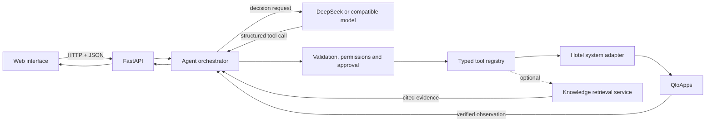

# Hotel Operations AI Agent

An end-to-end, tool-using AI agent that turns natural-language requests into safe and verifiable operations in hotel management software.

The project combines semantic decision-making with deterministic controls: the language model understands the request and proposes the next action, while the application validates permissions, arguments, confirmations, execution and post-action verification.

[Documentation française](docs/README.fr.md) · [Architecture](docs/architecture.md) · [Safety model](docs/safety-and-reliability.md) · [Evaluation](docs/evaluation.md) · [Demo scenarios](docs/demo-scenarios.md)

## What it demonstrates

- Multi-turn understanding of operational requests in natural language.
- Native function calling through a closed and typed tool registry.
- Stateful planning that adapts after each tool result.
- Live reads and protected writes against QloApps, an open-source hotel management application.
- Explicit approval before state-changing operations.
- Idempotency and post-write verification to prevent duplicate or falsely reported actions.
- An optional retrieval-augmented knowledge layer for procedures and documentation.
- Structured, privacy-aware traces without exposing hidden model reasoning.

## Supported workflows

| Area | Examples |
|---|---|
| Reservations | Search, create, update and extend a stay |
| Inventory | Check availability and allocate one or multiple rooms |
| Front desk | List arrivals, departures and guests currently staying |
| Operations | Check-in and check-out |
| Pricing | Compare verified offers and build detailed quotes |
| Services | Add catalogue-backed extras such as breakfast |
| Billing | Issue and retrieve invoices |
| Guest relations | Read and answer customer requests |
| Knowledge | Search procedures through the optional retrieval layer |

## Architecture



The model never receives unrestricted database or HTTP access. It can only select tools registered by the application. Every tool call is validated before execution.

## Request lifecycle

For a request such as _“Extend the selected booking by two nights if a room is available”_, the system:

1. loads the conversation state and selected references;
2. asks the model for one structured decision;
3. validates the selected tool and its arguments with Pydantic;
4. reads the booking and checks availability through QloApps;
5. returns each observation to the model so the plan can adapt;
6. creates a precise, short-lived approval for the proposed update;
7. executes the write once the user approves it;
8. reads the booking again and compares it with the approved request;
9. reports success only when the new state is verified.

## Engineering principles

### Probabilistic decisions, deterministic boundaries

The model handles language understanding, reference resolution and next-action selection. Application code owns the safety-critical invariants:

- schema validation;
- role-based permissions;
- approval binding and expiry;
- idempotency;
- financial calculations;
- maximum execution steps;
- post-write verification.

### Vendor isolation

QloApps-specific API details are isolated behind an adapter. The orchestrator and tool contracts operate on generic hotel concepts, making another hotel management application an adapter-level integration rather than a complete rewrite.

### Verified facts over generated facts

Availability, prices, taxes, booking status and invoice identifiers come from the connected application. The language model explains verified observations; it is not the source of truth for operational data.

## Technology stack

- Python 3.11
- FastAPI and Uvicorn
- Pydantic 2
- DeepSeek API with native function calling
- OpenAI-compatible model interface for alternative providers
- QloApps 1.7.x as the local operational system
- Docker Compose for the reproducible QloApps environment
- pytest for unit, contract and integration testing
- JSONL traces for observability

The orchestration loop is implemented directly instead of using LangChain or LangGraph. This keeps state transitions, approval rules and verification behaviour explicit and testable.

## Repository structure

```text
src/agentpms/
  agent/            orchestration, decisions and conversation state
  api/              FastAPI application and local web interface
  knowledge/        optional retrieval-service client and gateway
  llm/              DeepSeek and OpenAI-compatible model clients
  observability/    structured trace events
  pms/              generic hotel-system contract and QloApps adapter
  safety/           permissions, approvals and grounding checks
  tools/            typed tool definitions and registry
infra/
  qloapps/          reproducible local hotel-management environment
  llm/              optional local Qwen comparison server
tests/              unit, contract and optional live integration tests
```

The internal package keeps its historical namespace for compatibility; public documentation consistently uses generic hotel-management terminology.

## Quick start

### 1. Install the Python application

```powershell
py -3.11 -m venv .venv
.\.venv\Scripts\Activate.ps1
python -m pip install -e ".[dev]"
Copy-Item .env.example .env
```

Add your model API key to `.env`. Secrets are ignored by Git and must never be committed.

### 2. Start the local hotel-management environment

Follow [the QloApps setup guide](infra/qloapps/README.md), then seed the synthetic demonstration data.

### 3. Run the agent

```powershell
.\start_agentpms.ps1
```

Open `http://127.0.0.1:8090`.

### 4. Run the tests

```powershell
python -m pytest
```

Live integration tests are automatically skipped when local QloApps credentials are not configured.

## Knowledge layer

The operational agent can run independently from the retrieval layer. The companion [Reception Assistant RAG](https://github.com/RaoufKessouar/reception-assistant-rag) repository contains the document ingestion, chunking, embeddings, Qdrant retrieval, cited generation and evaluation pipeline.

The integration boundary is an optional knowledge tool: operational data comes from QloApps, while procedures and documentation come from retrieval.

## Safety highlights

- Separate read and write credentials.
- No unrestricted endpoint access from the model.
- State-changing tools remain hidden unless write credentials are configured.
- Approvals are actor-bound, request-bound, parameter-bound, single-use and time-limited.
- Duplicate writes are blocked through idempotency records.
- Every successful write is confirmed through a second read.
- Payments, destructive deletion and unrestricted configuration changes are outside the exposed tool set.

See [Safety and reliability](docs/safety-and-reliability.md) for the complete design.

## Evaluation approach

The repository combines conventional software testing with agent-specific evaluation:

- tool selection and argument validation;
- multi-turn state continuity;
- approval and idempotency properties;
- successful and failed write verification;
- ambiguity and missing-information handling;
- end-to-end scenarios against the local QloApps environment.

Current verified local result: **177 passed, 8 optional live-integration tests skipped**.

See [Evaluation](docs/evaluation.md) for metrics and methodology.

## Project scope

This repository focuses on the operational agent and its safety architecture. It intentionally keeps financial payments, destructive deletion and unrestricted administration outside the available tools. These boundaries make the demonstrated workflows reproducible while preserving a clear path toward stronger authentication, persistent state and production observability.

