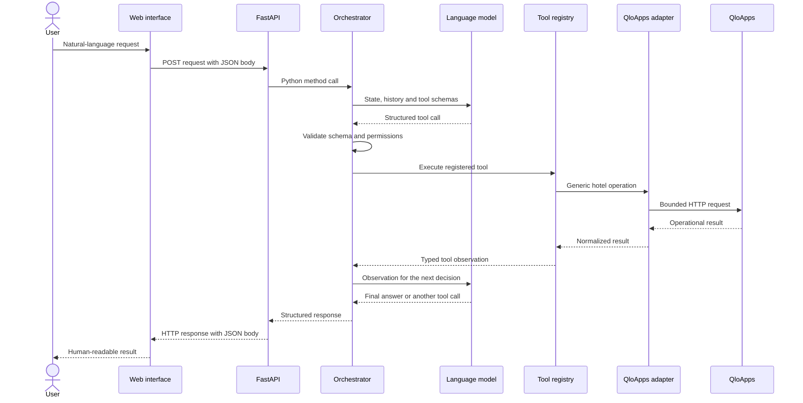

# Architecture

## Component responsibilities

| Component | Responsibility |
|---|---|
| Web interface | Collects user requests and displays responses or approvals |
| FastAPI | Validates HTTP input and exposes the application API |
| Orchestrator | Owns the execution loop, state, limits and control flow |
| Language model | Interprets language and proposes one structured next action |
| Tool registry | Exposes the closed set of capabilities available to the model |
| Pydantic models | Validate tool arguments and internal contracts |
| Hotel-system adapter | Translates generic operations into QloApps API calls |
| QloApps | Stores the operational source of truth |
| Knowledge gateway | Optionally retrieves procedures and cited documentation |
| Trace sink | Records observable events without hidden reasoning |

## End-to-end sequence



## Execution state

The state contains more than raw chat history. It records:

- the current objective;
- known facts and user constraints;
- intentionally unavailable fields;
- selected booking or customer references;
- public workflow steps;
- required and completed tools;
- room-selection evidence;
- pending approvals and completed writes;
- the current step count.

This structure allows the agent to understand follow-ups such as “use the first option” without asking for information already established.

## Model boundary

The model receives tool definitions as JSON Schema and must return one native function call or a final response. It never receives a generic HTTP client, database connection or arbitrary code-execution tool.

The orchestrator validates the selected function, converts its arguments into Pydantic objects and checks policy before any side effect.

## Adapter boundary

The adapter converts QloApps-specific responses into a common result:

```json
{
  "status": "success",
  "message": "Availability verified.",
  "data": {
    "options": []
  },
  "verified": true
}
```

This result is converted into a tool observation and sent back to the model as JSON during the next decision call.

## Bounded loop

Each request is limited to a configurable number of steps. A step can produce:

1. another tool call;
2. a clarification request;
3. an approval request;
4. a final answer;
5. a controlled error.

The bound prevents runaway loops and makes cost and latency easier to observe.

